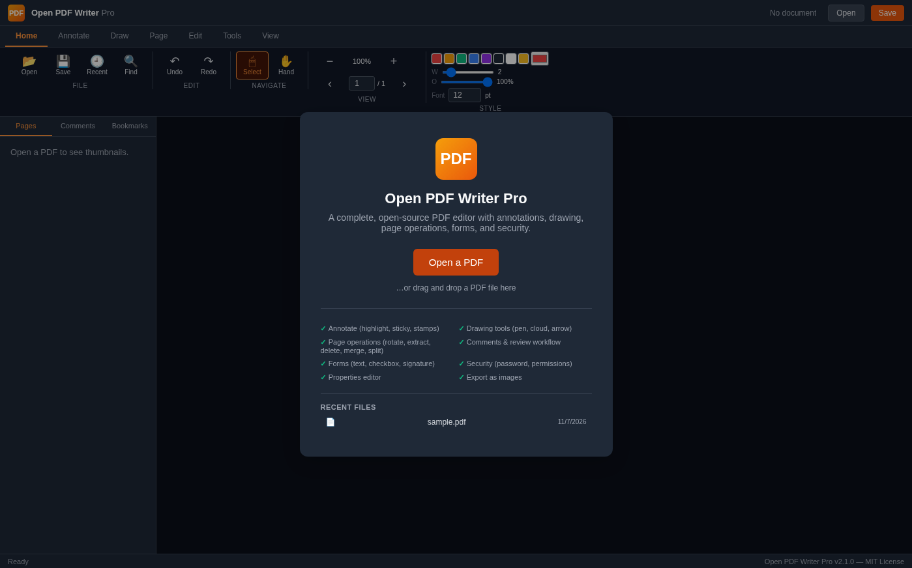
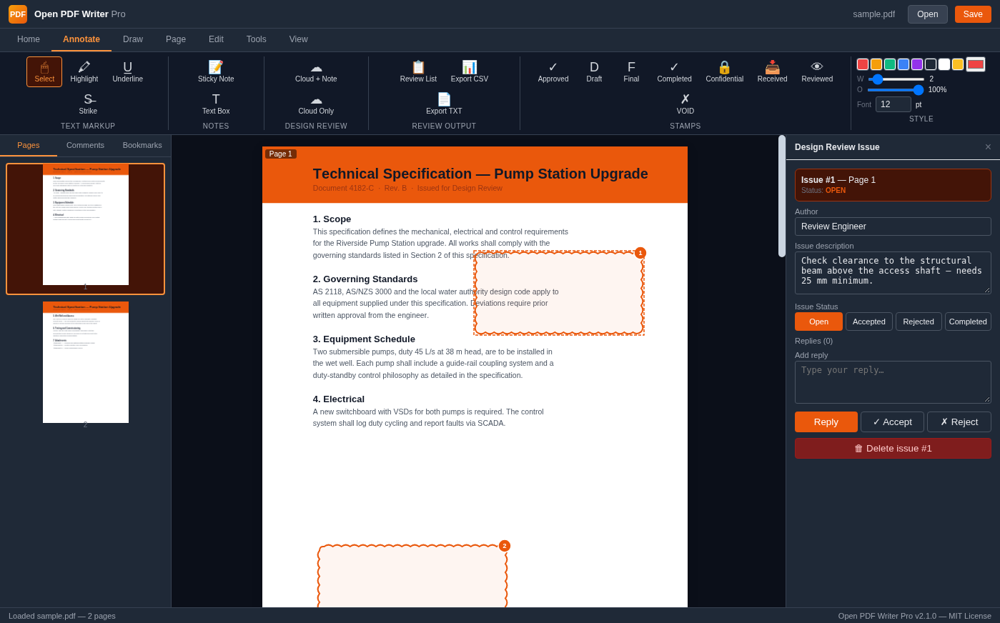
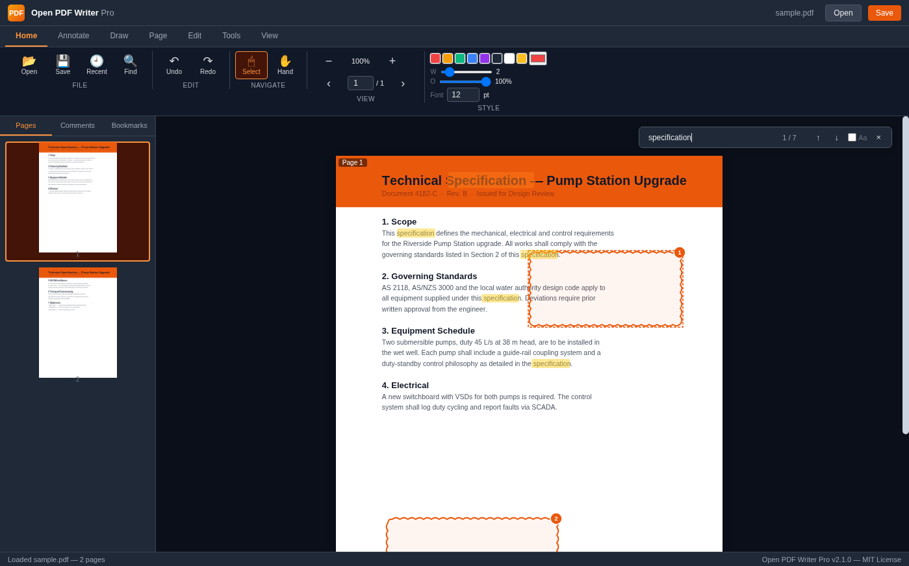
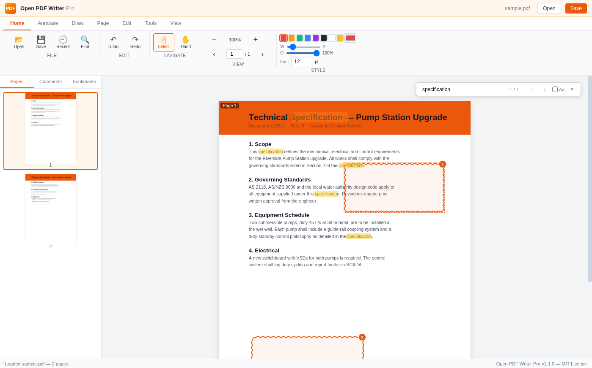
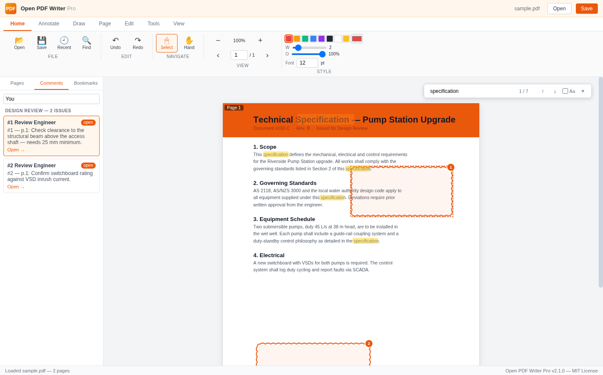

<div align="center">



# Open PDF Writer Pro

**The free, open-source PDF reader + writer. No subscription. No account. No cloud.**

A complete desktop PDF editor — annotate, draw, run design reviews with cloud marks,
rearrange pages, fill forms, and export — 100% offline, MIT licensed.

[](LICENSE)
[](https://github.com/foyrasel/Open-PDF-Writer-Pro/releases)
[](https://www.electronjs.org/)
[](https://mozilla.github.io/pdf.js/)
[](CONTRIBUTING.md)

**⭐ Star this repo if it saves you from a subscription! ⭐**

[Download for Windows](#-install) · [Run from source](#-run-from-source) · [Keyboard shortcuts](#️-keyboard-shortcuts)

</div>

---

## Why Open PDF Writer Pro?

| | **Open PDF Writer Pro** | Adobe Acrobat Reader | Foxit Free | Sumatra PDF |
|---|---|---|---|---|
| Price | **Free, MIT open source** | Free reader, paid editor | Free reader, paid editor | Free, open source |
| Annotations & drawing | ✅ all free | ⚠️ limited in free tier | ⚠️ limited in free tier | ❌ |
| Design review cloud marks | ✅ numbered issues + CSV export | 💰 Pro only | 💰 paid | ❌ |
| Page operations (rotate, extract, delete, merge, split, crop) | ✅ | 💰 Pro only | 💰 paid | ❌ |
| Full-text search | ✅ Ctrl+F, all matches highlighted | ✅ | ✅ | ✅ |
| Dark mode | ✅ | ✅ | ✅ | ⚠️ |
| Recent files | ✅ | ✅ | ✅ | ✅ |
| Works offline | ✅ 100% | ✅ | ⚠️ nags to sign in | ✅ |
| Telemetry / account required | **none** | nags to sign in | nags | none |
| Installer size | ~160 MB portable | 700 MB+ | 500 MB+ | **8 MB** |

*Comparison based on publicly documented free-tier features; last checked Nov 2026.*

> Sumatra is the right choice if you only read PDFs. Open PDF Writer Pro is for
> when you need to **mark them up, review them, and fix them** — without paying
> $180+/year for the privilege.

---

## Screenshots

**Design review with cloud marks** — numbered issue badges, status tracking, comments:



**Full-text search (Ctrl+F)** with all matches highlighted, and **dark mode**:

<p align="center">
  
  
</p>

**Comments sidebar** — every note, reply, and review issue in one list:

<p align="center">
  
</p>

---

## Features

### Reading & navigation
- Open, read, zoom (25–400%), rotate view, thumbnails sidebar, bookmarks
- **Full-text search (Ctrl+F)** — every match highlighted, jump with `Enter`/`F3`, case toggle
- **Dark mode** — the app goes dark, your document stays readable
- **Recent files** — last 10 documents, one click to reopen (start screen + Home tab)
- **Keyboard-first** — every tool is one key away (see table below)

### Annotating & markup
- Highlight, underline, strikethrough (with color, width, opacity controls)
- Sticky notes, text boxes, 8 stamps (Approved, Draft, Final, Confidential, …)
- Drawing: pen (freehand), rectangle, ellipse, line, arrow, cloud, eraser, fill toggle
- Undo/redo, comments with replies, accept/reject status per comment

### Design review (Acrobat/Bluebeam-style)
- **Cloud + Note** — draw a cloud around an issue; it gets an auto-numbered badge and opens a comment panel
- **Cloud only** — visual grouping without a comment
- Issue lifecycle: 🔴 open → 🟢 accepted / 🔴 rejected / 🔵 completed
- **Review List** — table of all issues with click-to-navigate
- **Export CSV/TXT** — share the issue register with the project team

### Page operations (saved into the PDF)
- Rotate pages, extract pages by range, delete, insert from another PDF, move, split, merge, crop

### Editing & output
- Add text, whiteout, embed images, edit document metadata (title, author, keywords)
- Form fields: text, checkbox, radio, signature
- Save with all annotations burned in as vector graphics · export pages as PNG or single-page PDFs · print

---

## 📦 Install

### Windows (portable — no installer needed)
1. Download **`OpenPDFWriter-Portable-2.1.0.zip`** from [Releases](https://github.com/foyrasel/Open-PDF-Writer-Pro/releases)
2. Right-click → **Extract All…**
3. Double-click **`Open PDF Writer.exe`**

> If the app flashes and closes on launch, install the
> [Microsoft Visual C++ Redistributable](https://aka.ms/vs/17/release/vc_redist.x64.exe) (one time).

### Run from source (Windows / macOS / Linux)
```bash
git clone https://github.com/foyrasel/Open-PDF-Writer-Pro.git
cd Open-PDF-Writer-Pro/electron-app
npm install
npm start
```

### Build your own binaries
```bash
cd electron-app
npm run dist:win     # Windows portable .exe
npm run dist:mac     # macOS .dmg
npm run dist:linux   # Linux .AppImage
```

---

## ⌨️ Keyboard shortcuts

| Keys | Action | Keys | Action |
|---|---|---|---|
| `Ctrl+O` / `Ctrl+S` | Open / Save | `V` / `H` | Select / Hand |
| `Ctrl+F` | **Find text** | `U` / `W` / `S` | Highlight / Underline / Strike |
| `Enter` / `Shift+Enter` | Next / previous match | `N` / `T` | Sticky note / Text box |
| `F3` / `Shift+F3` | Next / previous match | `P` / `R` / `O` | Pen / Rectangle / Ellipse |
| `Ctrl+Z` / `Ctrl+Y` | Undo / Redo | `L` / `A` / `C` | Line / Arrow / Cloud |
| `Ctrl+=` / `Ctrl+-` | Zoom in / out | `D` / `E` | Cloud + Note / Eraser |
| `←` / `→` | Previous / next page | `Delete` | Delete selected annotation |
| `Esc` | Close dialogs/panels | `Ctrl+/` | Show all shortcuts |

---

## Design review workflow (30 seconds)

1. Open your drawing or spec (`Ctrl+O`)
2. **Annotate tab → Cloud + Note** (`D`) — drag a cloud around a problem area
3. Type the issue description in the panel that opens
4. Repeat for every issue — each gets the next number badge automatically
5. **Review List** — see all issues, jump to any of them
6. **Export CSV** — send the issue register to your team
7. As issues are resolved, set each one to Accepted / Rejected / Completed — the badge color updates on the drawing

---

## Roadmap

- [x] Full-text search with match highlighting (v2.1)
- [x] Dark mode (v2.1)
- [x] Recent files (v2.1)
- [x] Design review cloud marks with numbered issues (v2.1)
- [ ] PDF compare (diff two revisions side by side)
- [ ] OCR for scanned documents (via tesseract.js)
- [ ] Fill existing AcroForm fields
- [ ] Multi-language UI (help wanted!)
- [ ] Auto-update & code signing
- [ ] winget / Homebrew distribution

---

## Contributing

Issues and pull requests are welcome! The whole UI lives in a single file
(`electron-app/renderer/index.html`), so it's easy to hack on — no framework build
step, just edit and `npm start`. See [CONTRIBUTING.md](CONTRIBUTING.md).

**Good first issues:** multi-language UI, new stamp types, macOS/Linux packaging & testing,
unit tests for the PDF operations.

## Tech stack

- **Electron 44** — cross-platform desktop shell
- **PDF.js 6.4** (Mozilla) — PDF rendering + text extraction
- **pdf-lib 1.17** — programmatic PDF manipulation
- Zero other runtime dependencies — the entire UI is one HTML file

## Known limitations

- **Password protection**: pdf-lib cannot encrypt PDFs; use [qpdf](https://github.com/qpdf/qpdf) (`qpdf --encrypt user owner 256 -- in.pdf out.pdf`)
- **Editing existing text**: PDFs don't support true text editing — use **Add Text** to overlay corrections
- **Scanned PDFs**: no built-in OCR yet (on the roadmap)

## License

MIT © Open PDF Writer contributors — free for personal and commercial use.
